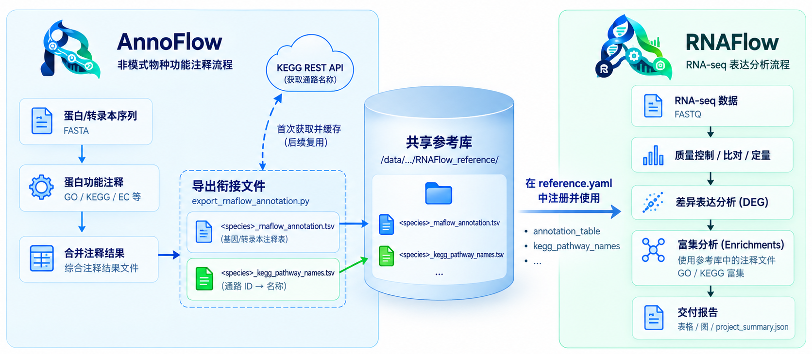

<p align="center">
  
</p>

# AnnoFlow

**语言 / Language**: [English](../README.md) | 简体中文

基因功能注释流程（Flow 家族成员）：eggnog-mapper 提供 KEGG/GO/COG/EC/Pfam/CAZy 全功能注释，KofamScan 提供 KO 交叉验证，整合层做双工具冲突裁决，可选 AI 驱动的逐蛋白可靠性审核。基于 Snakemake + Conda，模块化设计、质量过滤、可信度评估、交付与报告一体化。

版本：`AnnoFlow v1.0.0`（唯一版本来源为 `config/config.yaml` 的 `pipeline_version`）。

> **许可证**：AnnoFlow 采用 [MIT License](../LICENSE) 发布。

## 🤝 与 RNAFlow 联动

AnnoFlow 主要与 [RNAFlow](https://github.com/xsx123123/RNAFlow) 联动使用。非模式生物通常缺少现成的基因功能注释，AnnoFlow 通过 eggnog-mapper 与 KofamScan 为其蛋白序列生成 KO / GO 等标准化注释，并经 `export_rnaflow_annotation` 规则导出 RNAFlow 可直接消费的注释表（`rnaflow_annotation.tsv` + `kegg_pathway_names.tsv`），为下游富集分析提供注释信息。导出格式与对接方法见 [分析流程与结果说明](pipeline.md)。

<p align="center">
  
</p>

## 项目特点

- ✅ **模块化设计**: 规则按步骤编号（01-09），每个模块可独立开关，关闭后目标自动从 DAG 消失
- ✅ **输入 MD5 硬性门控**: 所有样本输入校验通过才进入注释，防止用错/损坏的数据跑完整流程
- ✅ **质量过滤**: 基于 E-value、Bit-score 等多维度过滤
- ✅ **可信度评估**: 三级可信度分级 (High/Medium/Low)，0-100 分评分体系
- ✅ **结果整合**: 对 eggnog 和 KofamScan 结果进行横向整合与 KO 冲突裁决
- ✅ **多样本合并**: 支持多样本结果合并与 KEGG 一致性比对，便于下游分析
- ✅ **Conda 环境**: 自动管理依赖环境（mamba 加速），保证可重复性
- ✅ **AI 驱动分析**（可选）: 逐蛋白可靠性评估（Ollama/OpenAI/Claude），含分层筛选与 Token 消耗追踪
- ✅ **交付与报告**: 自动生成交付清单（manifest + MD5）与 `project_summary.json`
- ✅ **灵活输入**: 支持 `.pep`、`.fa`、`.fasta`、`.faa`、`.protein` 及复合扩展名（如 `.fa.TD2.1k.pep`）
- ✅ **Schema 强制验证**: 启动即校验项目配置，路径错误 fail-fast，不浪费集群资源

## Flow 家族架构

AnnoFlow 对齐 Flow 框架规范（`Standard/FlowFrame` 子模块），配置优先级链：

```
config 四件套（仓库默认值） < analysisyaml（项目级） < --config key=value（命令行）
```

模块开关（`config/config.yaml`，关闭模块请写进 analysisyaml，不要用 `--config` 传布尔值）：

| 模块 | 默认 | 说明 |
|------|------|------|
| eggnog | true | eggnog-mapper 功能注释（KEGG/GO/COG/EC/Pfam/CAZy） |
| kofamscan | true | KofamScan KO 注释 |
| integrate | true | 双工具整合评分与冲突裁决 |
| merge | true | 多样本合并、KO 一致性比对与汇总 |
| ai | false | AI 逐蛋白可靠性评估（需配置 `ai_config`） |
| deliver | true | 交付 delivery_manifest（copy 模式） |
| report | true | `project_summary.json` 最小报告 |

依赖自动启用：开启下游模块时缺失的上游会被自动打开并记录警告日志。配置四件套、样本表、交付/报告与监控推送的详细说明见 [使用指南](usage.md)。

## 目录结构

```
.
├── snakefile                      # 主工作流：配置加载、schema 验证、目标生成
├── monitor_config.yaml            # OmicHub 监控推送配置模板（可选）
├── config/                        # 默认配置四件套 + 样本表模板
│   ├── config.yaml                # 流程控制：版本、模块开关、ai_config、脚本路径表
│   ├── reference.yaml             # 数据库参考路径（相对 reference_path 解析）
│   ├── run_parameter.yaml         # 线程数与过滤阈值
│   ├── cluster_config.yaml        # HPC 资源 profile 与队列映射
│   └── samples.csv                # 样本表模板（sample,sample_name）
├── schema/
│   └── config.schema.yaml         # 启动时强制验证的配置 schema
├── examples/
│   └── analysisyaml.example.yaml  # 项目级配置示例（复制修改后使用）
├── rules/                         # Snakemake 规则（按步骤编号 01-09）
│   ├── 01.common.smk              # 通用辅助函数（输入文件解析；无业务 rule）
│   ├── 02.input_md5.smk           # 输入 MD5 校验门控
│   ├── 03.eggnog.smk              # eggnog-mapper 注释与结果处理
│   ├── 04.kofamscan.smk           # KofamScan 注释与结果处理
│   ├── 05.integrate.smk           # eggnog + KofamScan 整合评分
│   ├── 06.merge.smk               # 多样本合并 / KO 一致性比对 / 汇总
│   ├── 07.ai_curator.smk          # AI 逐蛋白可靠性评估（可选）
│   ├── 08.deliver.smk             # 交付清单（delivery manifest）
│   ├── 09.Report.smk              # project_summary.json
│   └── utils/                     # 框架工具（目标生成、配置校验、资源、日志等）
├── scripts/                       # Python 处理脚本（eggnog/kofamscan_processor、
│                                  #   integrate/merge、export_rnaflow_annotation、
│                                  #   ai_curator、check_input_md5、deliver 等）
├── env/                           # Conda 环境配置（eggnog-mapper / kofamscan / py3.12 / openai）
├── docs/                          # 文档（见下方文档索引）
├── Standard/FlowFrame             # Flow 框架规范（子模块）
└── test/
    └── TD2.1k.pep                 # 测试数据（1000 条蛋白序列）
```

## 快速开始

### 1. 环境准备

确保已安装 [Snakemake](https://snakemake.readthedocs.io/)（9.9.0+）和 [Conda](https://docs.conda.io/)（推荐 Miniconda + mamba）：

```bash
conda install -n base -c conda-forge -c bioconda snakemake
```

### 2. 准备数据库目录

```
<reference_path>/
└── dataset/
    ├── eggnog-mapper/                  # eggnog-mapper 数据库（eggnog.db 等）
    ├── kegg_<date>_ko_dataset/         # KofamScan ko_list + profiles
    └── kegg_pathway_names.tsv          # KEGG 通路名缓存（首次运行自动生成，离线复用）
```

三个数据库组件的下载、生成与部署方法见 [参考数据库准备指南](database_preparation.md)。

### 3. 编写项目级配置（analysisyaml）

```bash
cp examples/analysisyaml.example.yaml /path/to/project.yaml
vim /path/to/project.yaml
```

填写 schema 必填的七项（五个路径键必须绝对路径）：

```yaml
project_name: my_annotation_project
species: Dioscorea_alata
sample_csv: /data/project/01.workflow/samples.csv   # 参照 config/samples.csv 模板
workflow: /data/project/01.workflow                 # 工作目录（Snakemake workdir）
data_deliver: /data/project/02.data_deliver
input_dir: /data/project/00.protein                 # 输入蛋白序列目录
reference_path: /data/jzhang/reference/AnnoFlow
```

### 4. 运行

```bash
# dry-run：查看执行计划，同时暴露配置/路径错误
snakemake -s /path/to/AnnoFlow/snakefile -n \
  --config analysisyaml=/path/to/project.yaml

# 正式运行
snakemake -s /path/to/AnnoFlow/snakefile --cores 8 --use-conda --conda-frontend mamba \
  --rerun-triggers mtime --logger rich-loguru \
  --config analysisyaml=/path/to/project.yaml
```

常用目标：`annotate`（仅注释）、`reports`（分析摘要）、`merge`（多样本合并）、`ai_analysis`（AI 分析）。完整命令与参数说明见 [使用指南](usage.md)。

## 流程概览

```
输入蛋白序列 → 01.qc MD5 硬性门控
             → 01.eggnog / 02.kofam 双工具注释与质量过滤
             → 03.merge 整合评分 + 多样本合并 + KO 一致性比对 + RNAFlow 导出
             → 04.ai 逐蛋白 AI 可靠性评估（可选）
             → data_deliver 交付清单 + project_summary.json
```

| 输出 | 内容 |
|------|------|
| `01.qc/md5_check.tsv` | 输入 MD5 校验结果（门控文件） |
| `01.eggnog/` | eggnog-mapper 注释结果与可信度评估 ⭐ |
| `02.kofam/` | KofamScan 注释结果与可信度评估 |
| `03.merge/` | 整合评分、多样本合并、KO 一致性、GO/KO 导出、`rnaflow_annotation.tsv` ⭐ |
| `04.ai/` | AI 逐蛋白评估报告（可选） |
| `{data_deliver}/` + `project_summary.json` | 交付清单与项目摘要 |

完整的流程图、各步骤规则说明、结果文件格式与统计报告解读见 [分析流程与结果说明](pipeline.md)。

## 文档

| 文档 | 内容 |
|------|------|
| [使用指南](usage.md) | 配置体系、模块开关、常用命令、测试数据、脚本独立使用、旧版迁移 |
| [参考数据库准备指南](database_preparation.md) | eggnog / KOfam / KEGG 通路名映射的下载、生成与部署 |
| [分析流程与结果说明](pipeline.md) | 流程图、各步骤说明、输出文件结构与格式、RNAFlow 对接 |
| [AI 注释分析](ai_analysis.md) | 逐蛋白评估、分层筛选策略、API 密钥安全 |
| [常见问题](faq.md) | 运行、数据库、过滤、多样本、AI 等常见问题 |
| [过滤与可信度评估标准](filtering_standards.md) | 两个 processor 的评分体系详解、阈值参考 |
| [KEGG 注释工具教程](kegg-annotation.md) | KEGG REST / KofamScan / eggnog-mapper 原理与手动用法 |

外部参考：[Snakemake](https://snakemake.readthedocs.io/) · [eggnog-mapper](https://github.com/eggnogdb/eggnog-mapper) · [KofamScan](https://www.genome.jp/tools/kofamkoala/)

## 依赖

- Python 3.12（`env/py3.12.yaml`：pandas, loguru, rich, requests 等）
- eggnog-mapper 2.1.13（`env/eggnog-mapper.yaml`）
- KofamScan 1.3.0（`env/kofamscan.yaml`）
- Snakemake 9.9.0+
- Conda/Mamba

## 引用

如果使用本流程，请引用：

1. eggNOG-mapper v2: [https://doi.org/10.1093/molbev/msab293](https://doi.org/10.1093/molbev/msab293)
2. eggNOG 5.0: [https://doi.org/10.1093/nar/gky1085](https://doi.org/10.1093/nar/gky1085)
3. KofamScan: [https://doi.org/10.1093/bioinformatics/btz859](https://doi.org/10.1093/bioinformatics/btz859)
